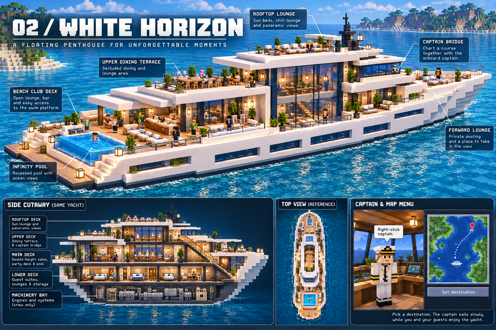

# White Horizon — shared yacht design and implementation plan

Status: planning only, 2026-10-14. The user approved the **visual direction**, not the
layout below or its technical implementation. No yacht gameplay, model, dependency,
or moving-floor prototype has been built in this stage.

Target: Minecraft **1.21.1**, NeoForge **21.1.235**, Java **21**, Mojang names with
Parchment **2024.11.17**. Start with a luxurious player-owned social space for about
16 guests; travel is slow background activity controlled by an NPC captain.



This curated copy preserves the supplied image at
`output/imagegen/grand-yacht/iterations/02-white-horizon.png`. That output path is
ignored by Git; the copy makes the brief usable in a shared checkout.

## Decision: prove a moving block sub-level before detailed art

Recommend a **Sable-backed rigid moving block structure**, with a Practice Mod
controller for ownership, captain travel and presentation. Players walk as normal
entities on actual local block collision; they are not mounted passengers. Author
structural blocks/stairs first, then add restrained Blockbench trim. Keep the yacht
level, with translation and yaw only, for the first release. Do not implement ocean
roll, pitch, destructible hull physics or arbitrary player rebuilding initially.

This is an architectural recommendation conditional on the bounded prototype below,
not a claim that the existing repository already supports it. If the dependency or
movement gates fail, preserve the design and report the failure; a stationary yacht
can be a separate interim feature, but cannot satisfy walking during travel.

### Repository evidence

The relevant code was read, not merely inferred from vehicle screenshots:

| Existing source | What it establishes / reuse boundary |
| --- | --- |
| [SubmarineEntity](../../src/main/java/com/bilal/practicemod/SubmarineEntity.java) | Extends Boat; permits one player. `toggleCabin` parks the vessel, `move` refuses parked movement, and `tickCabin` clamps a mounted player's X/Z to a small aisle at fixed Y. No general floor collision, jumping or stairs. |
| [SubmarineInteriorGameTests](../../src/main/java/com/bilal/practicemod/SubmarineInteriorGameTests.java) | Explicitly checks that cabin walking leaves the hull parked. Storage and furniture-target tests are useful patterns, not evidence for moving multiplayer interiors. |
| [SubmarineCabinPayload](../../src/main/java/com/bilal/practicemod/network/SubmarineCabinPayload.java) | Input-intent payload pattern; yacht commands should likewise be server-validated. Do not reuse one controlling passenger's cabin coordinates for multiple guests. |
| [SubmarinePassengerMixin](../../src/main/java/com/bilal/practicemod/mixin/SubmarinePassengerMixin.java), [SubmarineCabin](../../src/main/java/com/bilal/practicemod/SubmarineCabin.java) | Pilot-specific dry-air and visual water handling. They do not create a dry multi-person hull volume. |
| [JetskiEntity](../../src/main/java/com/bilal/practicemod/JetskiEntity.java) | Fixed rider attachment, vehicle motion and interpolation; not independent walking on a surface. |
| [PracticeMod](../../src/main/java/com/bilal/practicemod/PracticeMod.java), [SubmarineRenderer](../../src/main/java/com/bilal/practicemod/SubmarineRenderer.java) | Small submarine entity bounds (1.375 × 0.5625) and separately inflated render bounds. Visual hull dimensions do not establish collision. A yacht cannot inherit these bounds. |
| [build.gradle](../../build.gradle), [gradle.properties](../../gradle.properties) | Correct target versions; PAL, Mocha, Javassist and Bendy are present. There is no moving-structure physics dependency. |

See also [Deepseeker gameplay](../../DEEPSEEKER.md), [art direction](../../ART_DIRECTION.md),
[source map](../SOURCE_MAP.md), and [project guidance](../../AGENTS.md).

### Alternatives and dependency tradeoffs

| Approach | Fit with this repository | Decision |
| --- | --- | --- |
| Enlarge Boat / ordinary rideable entity | Easy rendering and seat reuse. One solid AABB cannot express a hollow multi-floor ship. Mounting suppresses normal walking; model cuboids do not become collision. | Reject for the requested feature. |
| Extend the submarine's local mounted controller | No new library, but must invent vertical motion, stairs, collision, multiple occupants, swimming, camera, combat and boundary transitions. Existing parked behavior intentionally avoids these problems. | Reject as foundation. |
| Custom unmounted kinematic collider | Can use authored boxes and yaw-only motion without a dependency. Requires swept oriented collision, world/ship contacts, player packet validation, prediction, jump momentum and support tracking. Extensive movement mixins and long-term Minecraft maintenance. | Technically possible fallback research, not a small extension or the preferred implementation. |
| Sable sub-level | Structural blocks, entities and block entities share a moving coordinate space. Adapts yacht gameplay around an existing moving-world system; conflicts with global movement/render mixins remain a real risk. | **Prototype first; recommended backend.** |
| Create Aeronautics plus Sable plus Create | Offers assembly and vehicle systems, but brings substantial content and a propulsion/control model beyond this fixed yacht. | Viable if later requirements need Create machinery; unnecessary initial dependency chain. |
| Valkyrien Skies / unofficial NeoForge ports | Another moving-world architecture. Official repository inspected defaults to 1.20.1; separate unofficial projects advertise 1.21.1 NeoForge. Version/API/addon compatibility cannot be assumed across ports. | Secondary candidate, not an automatic supported drop-in. |
| Static blocks or remote interior dimension | Vanilla collision is attractive. Remote interiors break continuous views, seamless outside walking and jumping into the surrounding ocean. Repeatedly moving world blocks is destructive and causes update churn. | Stationary prototype only; not the finished travel solution. |

External evidence checked 2026-10-14 (publisher/source pages, not multiplayer tests):

- [Sable publisher page](https://www.curseforge.com/minecraft/mc-mods/sable)
  lists NeoForge 2.0.6 for 1.21.1, describes interactive sub-levels and a Rapier-based
  physics pipeline, and warns of extensive mixin compatibility risks.
- [Sable source](https://github.com/ryanhcode/sable) describes sub-level chunks,
  entities and block entities. Its PolyForm Shield license and native Rust component
  require distribution/license and platform checks before adopting or modifying it.
- [Source version properties](https://github.com/ryanhcode/sable/blob/main/gradle.properties)
  identify 2.0.6, Java 21, MC 1.21.1 and NeoForge 21.1.228.
  [NeoForge metadata](https://github.com/ryanhcode/sable/blob/main/neoforge/src/main/resources/META-INF/neoforge.mods.toml)
  uses that minimum and marks Create/Flywheel optional. Thus 21.1.235 fits the declared
  range; this is not a binary compatibility test. These main-branch links are mutable.
- [Create Aeronautics publisher page](https://www.curseforge.com/minecraft/mc-mods/create-aeronautics)
  lists 1.3.2 for NeoForge 1.21.1 and requires both Create and Sable.
- [Official VS source](https://github.com/ValkyrienSkies/Valkyrien-Skies-2) and
  [unofficial port publisher](https://www.curseforge.com/minecraft/mc-mods/vs-unofficial-port)
  are distinct upstreams. A port would need its own pinned artifact audit.

Planned required addition: Sable on **server and every client**, using a pinned
1.21.1 NeoForge artifact. No library was installed here. Before adding it, record the
release hash, source commit, resolved transitive/bundled dependencies, mod metadata,
license obligations and native architecture support (including this Mac and Linux
server). Do not infer required dependencies from a build's optional compatibility
version list. Verify release-JAR metadata against the source above. Do not shade a
whole physics mod into Practice Mod. Initially make yacht availability require the
backend; missing backend must produce a clear load/configuration error, not discard
saved yachts. A thin `YachtPlatform` adapter should isolate framework-specific APIs.

## Coherent dimensions and vertical section

Proposed overall hull/deck envelope: **60 long × 17 wide** blocks, including the stern
platform; no length increase yet. Main interior width is 11; two exterior side walks
and hull/rail thickness consume the remaining beam. Aim for 16 social players, not
16 simultaneous private bedrooms. Six double guest cabins provide 12 beds.

Use metres/blocks in layout data. Origin is main-deck center, Y up, +Z toward bow,
+X starboard. Longitudinal station `s = z + 30`: stern s=0, bow s=60. Thus
X=[-8.5,8.5], Z=[-30,30]. Stations below are half-open zone boundaries, not promises
that all walls have zero thickness. Reserve partitions within each zone. Authoring
uses 16 model units per block, with an explicit exporter conversion.

| Surface | Local Y | Extent / headroom |
| --- | --- | --- |
| Keel underside | -9 | Central machinery keel; stepped upward toward ends |
| Machinery floor | -8 | s=26..42, usable X=-5..5; ceiling -4.5, clear 3.5 |
| Guest floor | -4 | s=12..50; normal ceiling -0.5, clear 3.5 |
| Design waterline | -5 | Nominal 4-block draft; route requires at least 5 water blocks depth |
| Swim platform | -2 | s=0..3, exposed above water, boarding ladder to sea |
| Main deck | 0 | s=3..58; ordinary ceiling 3.5, clear 3.5 |
| Upper deck | +4 | s=12..52; salon void removes central floor s=26..42 |
| Roof lounge | +8 | s=26..50; roof slab underside 7.5 |
| Canopy / mast | +11 / +14 | Canopy gives 2.5 clear; mast at forward roof edge |

Main salon floor to roof underside is **7.5 blocks clear**, with an upper gallery.
Use 0.5-thick deck slabs as the design budget; block implementation may use slabs
and explicit collision blocks. Waterline is deliberately below guest floors, avoiding
fully submerged bedrooms. Hull buoyancy/draft still need engine validation. Nominal
waterline-to-mast air draft is 19 blocks; navigation must test the actual whole volume.

The supplied cutaway exaggerates the machinery depth and depicts stairs that do not
align with the perspective. Keep a central machinery bay, not an entire extra living
floor. The plan below replaces that diagonal stair with two stacked stair cores.
The overhead projection's apparent fore/aft ambiguity is resolved by the **pool at
the stern**, bridge forward, angular taper at the bow. Broad white overhangs remain,
but cannot occupy headroom or close the salon void.

## Readable deck plans

Stern is left, bow right. Diagrams are adjacency schematics; station/coordinate tables
and stair dimensions govern measurement. `A/B` are stair cores, `=` is connected
circulation, `V` is open salon void, `G` is gallery. Every door opens into a passage;
no suite is a passage to another suite.

```text
                         STERN                         BOW
stations       0   3   12  18    26       34      42    50  58 60
MAIN Y=0       swim |POOL| beach/bar A | DOUBLE-HEIGHT | B/ |fore|tip
port walk          ===========================================
center             pool  party/dining |     SALON     |foyer|sun
starboard walk     ===========================================

UPPER Y=4              | dining terrace A |G V V V V G|bridge/B|
port edge              ==================G V V V V G==========
starboard edge         ==================G V V V V G==========
                         terrace crosswalk   void     crosswalk

ROOF Y=8                                 | lounge / sunbeds  B |
                                         | open loop / mast    |

LOWER Y=-4         pool service |pair 1| A |pair 2|pair 3| B/store|
center corridor                 ================================
                          each pair = port + starboard guest cabin

MACHINERY Y=-8                       A --> | engines / utilities |
                                          | 2-wide service aisle|
```

| Deck / stations | Space and access reservation |
| --- | --- |
| Main s=0..3 | Swim platform; two side stairs rise to main deck at s=3..7. Fixed boarding ladder reaches water. No guests cross the pool to enter. |
| Main s=4..12 | Pool water X=-3.5..3.5, s=4..11, surface Y=-0.25, basin bottom -1.75. Wide side bypasses; seat ledge and steps at forward edge. Aft glazed overflow edge plus contained return gutter. |
| Main s=12..18 | Open beach-club seating, bar on port edge and clear center party floor. Lower guest cabins begin under this zone, beyond pool basin. |
| Main s=18..26 | Core A at X=-6..-1; dining/service on starboard, 2-wide north/south cross-passages at core ends. Main salon entrance at s=26, 3-wide. |
| Main s=26..42 | Salon X=-5.5..5.5: central 6-wide open social area, sofas along perimeter with 2-wide routes around them. Side glazed doors connect both promenades. No mezzanine spanning the central void. |
| Main s=42..50 | Core B at X=1..6; port foyer/quiet lounge, central 2-wide connector. Forward glazed doors reach bow lounge. |
| Main s=50..58 | Foredeck sun lounge; center 3-wide path. Seating ends before taper constricts passage. s=58..60 is non-walkable bow structure behind a rail. |
| Upper s=12..26 | Dining terrace/second bar, core A. Keep a 2-wide route around tables and across the deck at s=24..26. Overhang shelters main beach club. |
| Upper s=26..42 | Void X=-3..3; galleries X=-5..-3 and 3..5, each 2 wide; 1.5-high rails at void edge. Cross-connections at s=24..26 and 42..44 make a complete loop. |
| Upper s=42..50 | Bridge primarily X=-5.5..-1; captain/console forward, center aisle to B and public gallery. Captain reachable without crossing console or stair steps. |
| Upper s=50..52 | Small forward viewing terrace and bridge overhang; not another full deck over foredeck. |
| Roof s=26..50 | Sunbeds aft, lounge seating center, canopy over part of lounge, mast forward at s=48. Core B arrives within s=42..50; 2-wide path from its landing circles all furniture. |
| Lower s=12..18 | Two guest cabins, each approximately 5.5 × 6 gross, one double bed, wardrobes, compact washroom; clear door/bed access governs furniture count. |
| Lower s=18..26 | A, linen and laundry opposite; center passage continues. No guest room under a stair landing. |
| Lower s=26..34 and 34..42 | Four larger guest cabins, two each side; approximately 5.5 × 8 gross before partitions. Narrow center corridor X=-1..1 connects all six cabins and both cores. |
| Lower s=42..50 | B, luggage/storage and crew service lockers opposite. Forward of s=50 becomes tapered utility void, not accommodation. |
| Lower s=4..12 | Pool equipment/basin zone. Access from an end service door at s=12; raised basin intrudes into ceiling, so no standing guest route beneath it. |
| Machinery s=26..42 | Port/starboard engine banks; central 2-wide aisle. Access via A's bottom landing and a short service connector s=24..26. Locked crew door, owner service access. No functional simulated engine dependency initially. |

Exterior midship main walks reserve X=-7.5..-5.5 and 5.5..7.5. Cabin walls/rails
sit outside those clear widths; planters and furniture cannot reduce them. Bow beam
steps from 17 at s=50 to 13 at s=54, 9 at s=58 and 3 at s=60; promenades merge into
the center path before narrowing. Lower rooms finish at s=50 before the taper.

### Stairs, doors and actual player clearance

- **A:** X=-6..-1, s=18..26, machinery → lower → main → upper.
  **B:** X=1..6, s=42..50, lower → main → upper → roof.
  Their plan positions remain the same on every floor; the salon sits between them.
- Each core reserves **5 × 8 blocks**. Two parallel flights each 2 wide, separated
  by a 1-wide divider; four 1-block treads per flight, each rising 0.5, provide a
  4-block deck rise over two flights. Two-block-deep landings at both ends occupy
  the other four longitudinal blocks. Both end landings span the core width.
- The entry-end landing carries lower-floor entry and upper-floor exit on opposite
  lanes; the far landing is at +2 relative height. Repeat the same footprint above
  with 4-block vertical spacing. Open the full stairwell through each intervening
  slab. Reserve **2.5 minimum vertical clearance above every tread/landing**, including
  underside of the next stacked flight; check actual stair shapes with a player.
- Deck connectors at s=18..20 / 24..26 for A and 42..44 / 48..50 for B meet those
  landings. On the lower deck they meet the center corridor at the inner core wall.
  Machinery's final connector reaches the central aisle without going through an engine.
- Public door clear openings: 2 wide × 3 high; main salon entrance 3 wide × 3 high.
  Cabin and service doors also reserve 2 × 3 so passing and furniture handling are
  comfortable. Use paired/sliding doors whose open collision never blocks the route.
- All general passages are 2 clear; social entrance/party lanes 3 clear. Furniture
  access at least 1 clear; primary routes never use that narrower furniture gap.
  Public guardrails target 1.5 high with continuous collision; stairs have handrails.
- Stern stairs: X=-6..-4 and 4..6, s=3..7, four half-block rises from Y=-2 to 0;
  reserve 2 × 2 arrival landings at s=7..9 beside the pool.
- Pool entry uses internal half-block steps at its forward edge. Pool users must
  be able to climb out while the hull moves. Pool water is local contained fluid,
  not world ocean blocks; disable travel if the backend cannot preserve containment.

The graphical concept supplies style; these numerical constraints resolve its
contradictions. A graybox must verify the furniture/corridor fit before final art.

## Moving collision and multiplayer contract

The implementation must have **one authoritative motion/collision system**. Let the
backend handle local blocks, entity contacts and movement replication. Do not layer
per-tick player teleports or Boat riding on top of its walking controller.

The design contract is `worldPoint = translation + yawRotation * localPoint`.
Store persistent anchors in vessel-local space with vessel UUID and dimension.
Render the vessel and supported occupants using the same interpolated transform and
simulation timestamp. Physics uses the authoritative tick transform, never the
render interpolation. Keep the camera free to look independently; do not force the
player's look direction whenever the hull turns.

- Floors, stairs, glass, ceilings, hull walls and rails have real local collision.
  World terrain and other vessels collide with the hull, including during turns.
  Broadphase bounds are for discovery only; they cannot be a solid enclosing box.
- A grounded player's support contact conveys translation and angular motion at the
  contact point. Jumping releases support and retains appropriate linear plus
  tangential hull velocity once. Gravity, head collisions, landing, sprinting and
  sneaking must work. The player must not be stuck to the ship midair, moved twice,
  or allowed to fall through between simulation updates.
- A local overlap/broadphase query must discover every part of the 60-block hull,
  even when its origin is outside normal nearby-entity range. Use framework sub-level
  collision queries, not just an entity-origin search.
- Boarding is walking across a stationary gangway or climbing a water ladder.
  Gangway deploys only at zero speed with a validated dock landing; retract before
  travel. Check occupied ramp before retraction. Rail gates use synchronized collision.
  Boarding a moving ship from the water is a contact transition to test, not a teleport.
- Walking off/jumping off transfers to world physics exactly once. Swimming outside
  is ordinary ocean behavior. A person overboard does not remain attached; request
  a safe stop through a rescue control. Do not teleport everyone to a seat to travel.
- Framework movement packets must still pass server reach, speed, collision and
  support validation. Yacht-specific payloads carry intent and vessel identity;
  reject NaN, stale IDs, cross-dimension targets and unauthorized requests. Never
  globally disable movement anti-cheat to conceal platform correction failures.
- Remote observers need consistent occupants, doors and captain transforms. Test
  late join, tracking range entry/exit, hull chunk crossing, two ships nearby and
  owner logout. A seated emote may use a local seat attachment only while seated.
- Dry-room volumes and pool-water volumes are distinct. Verify breathing, swimming,
  fog and world-ocean rendering at hull intersections for **every** occupant, including
  observers. The existing pilot-only submarine water mixins are insufficient.
  Do not delete ocean blocks along the route to make a dry interior.

## Captain, ownership and travel

Right-click the captain on the bridge to open an in-mod world map. Show yacht position,
heading, explored shoreline, known destinations, route, ETA and Stop. The captain
remains associated with the vessel and uses local bridge navigation; he is not a
Boat controller seat and does not need to walk a world-space path as the ship moves.

Map scope initially: surveyed ocean region and server-registered water anchorages.
Selecting any map point requests validation; land, shallow water, unreachable water
and unsurveyed regions display a reason rather than starting travel. No mandatory
external minimap dependency. Map tiles are cached from authorized known terrain;
route planning is bounded and must not synchronously generate the whole world.

Server owns the route and state machine:
`DOCKED → PREPARING → SAILING → APPROACHING → STOPPED`, with `BLOCKED` and
`RECOVERY` states. Revalidate permissions, loaded corridor, ramp state and destination
when starting. Captain acknowledges accepted orders; guests can inspect the map but
only owner/delegated navigators set routes. Shared emergency stop is rate-limited.

Proposed initial limits: 0.8 blocks/s cruise (0.04/tick), 0.1 blocks/s² acceleration
and braking, 1 degree/s maximum yaw, 0.2 blocks/s near docks. These are comfort
budgets to tune, not measured properties. Never use catch-up teleportation after lag.
At cruise the ideal straight stopping distance is v²/(2a)=3.2 blocks; add tick/network
and obstacle margins (initial 8-block minimum forward reserve), then test under load.

Navigation must account for a **60 × 17 × full-height swept footprint**, not a point
or a vanilla boat path. Build a bounded water navigation graph, inflate obstacles by
hull dimensions plus at least 2 blocks horizontal margin and 1 below keel. Refine
candidate routes with heading-aware swept collision checks. A 17-block beam requires
at least 21 blocks of straight clear channel; turns can require far more. Rotation
sweeps the corners roughly 31.2 blocks from the hull center, so never spin in a narrow
channel just because the center is clear. Test bridge/overhang clearance to mast tip.

Destinations store dimension, anchorage position, allowed heading and berth clearance.
Route to the anchorage rather than ramming a shoreline marker. Recheck terrain changes,
other ships and entities ahead each tick. Brake within known clear loaded water when
blocked, recompute a bounded route, and remain stopped if none exists. Avoid pushing
swimmers against shore. A sudden obstacle inside the stopping envelope calls for a
collision-safe hold at the last valid transform, with no damage or teleport through it;
this exceptional stop may be visually abrupt and must be tested.

Use engine-compatible chunk tickets for hull overlap plus braking/look-ahead corridor;
preload before motion, cap tickets and simultaneous yachts per server, release trailing
tickets only after occupants and hull clear them. Test rotated bounding coverage.
If chunks cannot load, stop before their boundary. Far routes advance survey/loading
incrementally; no unlimited tickets. No offline cruising initially: stop safely when
last occupant leaves, save, then release travel tickets. The vessel must remain
persisted even when no player is nearby.

## Persistence and shared use

Persist stable yacht UUID, owner UUID, ACL (guest, navigator, steward), backend
sub-level ID, schema version, dimension, last safe transform, travel state, captain
identity, inventory IDs/content, doors, pool state and approved layout revision.
Do not duplicate backend block storage in entity NBT. Store controller records in
server SavedData or a version-matched equivalent and link to the engine's persistence.
Use a reconcile-on-load transaction/journal so a crash cannot create two yachts or
orphan inventories. On restart default to STOPPED and revalidate the saved route.

Store reconnect anchors by vessel UUID and local position for aboard players. Resolve
only after the ship loads, validate headroom/support, otherwise use a recorded safe
dock/world spawn fallback. Death, teleport, dimension travel and logout clear live
support state. Initial bedroom beds support rest; do not promise mobile respawn until
vessel-aware respawn is implemented and tested. Guests use shared lounges and assigned
cabins; steward permission controls storage/service doors. Protect structural blocks
from guest edits/explosions initially. Only permit packing/removal while stopped,
empty of occupants, and after explicit inventory handling; never silently void contents.

## Model, texture and collision organization

The implementation should be a block-based rigid hull with authored trim, not one
massive entity model. Proposed canonical assets (future files, not created here):

- `src/main/yacht/white_horizon.layout.json`: stations, rooms, structural block palette,
  stairs, doors, clearance volumes, named anchors and schema version.
- `src/main/blockbench/white_horizon/`: editable hull trim, rail, glass-frame, furniture,
  bridge and canopy modules; module origins documented in a manifest.
- A scoped exporter produces the local structure/template, block models, textures,
  simplified collider data where needed, and an anchor/clearance audit. Update
  [SOURCE_MAP](../SOURCE_MAP.md) when actual source/export paths exist; do not invent
  a runnable exporter command in advance.

Group by hull shell, deck slabs, stair cores, partitions, glass, rails, furnishings,
pool and technical fittings; subdivide by deck and roughly 16-block longitudinal
sections. Use one root rigid-body transform. Doors pivot at hinges or slide on a
single local axis; bridge controls and mast do not become separate rigid bodies.
Anchor the captain, furniture menus and lights to named local transforms. Geometry,
collision and interaction rays must use the same coordinate conversion.

Main collision comes from structural block shapes: slabs, stair treads, walls and
rails. Simplify decorative furniture to sensible boxes; cushions, plants, seams and
lamps do not add dozens of collision pieces. Solid glass needs collision even though
transparent. Hollow rooms remain empty. Rotated local shapes require framework
collision support, not world-axis boxes that fill the salon during turns. Hull/world
collision and player/interior collision may use different simplified shapes but must
agree at traversable boundaries. Audit minimum headroom against collision, not mesh.

Use crisp reusable material tiles at a starting density of 16 texels/block: warm white
hull, subtle off-white underside, charcoal frames, blue glass, pale wood deck, warm
lighting. Repeated wood/plank UVs avoid a giant unique 960-pixel-long hull unwrap.
Share small material atlases; detailed signs/instruments may use separate higher-density
sheets. Avoid photoreal noise and excessive tiny seams. Preserve broad angular stepped
bow panels, thick roof overhangs and the tall blue-glass salon as silhouette priorities.

Let the sub-level renderer handle structural chunks; custom trim uses transformed
per-section bounds. Cull by actual section volume, not root distance. Never hide an
occupied interior when its exterior origin leaves the view. Start with frustum culling;
portal/room occlusion is later optimization and must respect the salon void. Opaque
hull/frame first, carefully sorted glass and contained water later; avoid doubled
coplanar glass faces. Sample lighting per section/local surface rather than one entity
light value for all rooms. Test first person, third person, shore views, underwater
views and distance before using shader/LOD shortcuts. Use simple far hull/roof LOD only
when no nearby interior interaction is visible. Profile before setting final budgets.

## Bounded prototype and implementation sequence

Do not begin detailed yacht modeling until phases 0–2 meet their exit criteria. These
are engineering gates, not extra user approval stops. Timeboxes are estimates and
limits on scope, not a promise to implement this stage now.

| Phase | Bounded work | Exit evidence |
| --- | --- | --- |
| 0: dependency spike, 1–2 days | Pin/audit Sable release; load this exact mod on Java 21 / NeoForge 21.1.235 client and dedicated server. Inspect transform, constraint, collision, fluid, save and networking APIs at the pinned source commit. Confirm yaw-only controlled travel is possible without bypassing collision. | Resolved dependency manifest, native-platform results, mixin conflict list, a moving test slab. If unsupported, record blocker before art. |
| 1: moving-floor fixture, 3–5 days | One 12 × 9 two-floor gray platform with a 5 × 8 U stair, 4-block deck separation, doorway, rail/gate, chair, chest and 3 × 3 pool. World dock beside it. Script straight motion, acceleration, turn and stop; no captain/map art. | Dedicated server plus two real clients pass matrix below; telemetry and reproducible commands recorded. |
| 2: scale/layout graybox, 2–3 days | Expand structural collision to 60 × 17 with full floor elevations, both cores, salon void, six cabin placeholders and pool basin. Use untextured/simple blocks only. | Complete walking route, measured clearances, 16-client load target, full-size turning/chunk tests and first-person review. |
| 3: service foundation | Stable yacht IDs/ACLs, backend adapter, saved controller record, captain interaction, limited water map and one validated route. | Save/reload/reconnect and authorization tests; safe obstacle stop and ticket cleanup. |
| 4: detailed art and furnishing | Canonical modules/exporter and refined silhouette; preserve proven stairs/collision. | Geometry/clearance audit plus actual in-game inside/outside visual review. |
| 5: travel hardening | Larger bounded route graph, multiple yachts, failure recovery and performance tuning. | Multiplayer soak, restart/crash recovery, renderer compatibility report. |

Prototype motion matrix, all initially **unexecuted**:

| Scenario | Required observation / proposed measurable pass threshold |
| --- | --- |
| Stand still 10 min on moving/turning deck | No support loss; grounded relative drift <=0.05 block absent input. |
| Walk/sprint/sneak, collide with walls, climb stairs in both directions | No penetration >0.05 block, no falling through; continuous full route without jumps required on stairs. |
| Jump at center and bow during acceleration/turn/stop | One inherited velocity contribution; consistent apex/landing; no forced attachment or false flight kick. |
| Board/disembark, moving water ladder, jump into sea, pool entry/exit | Exactly one support transition; normal ocean swimming outside and dry rooms inside; no duplication or invisible barrier. |
| Two clients pass on stairs, third observer/late join | Correct relative poses and hull location; no persistent correction loop or visibility loss. |
| 0/100/200 ms RTT, jitter up to 50 ms, 1% loss | No fall-through/kick over 10 min each; target p95 local correction <=0.15 block and max <=0.5 outside deliberate recovery. Log failures rather than smoothing them away. |
| Chunk boundary, 90-degree turn, sudden obstacle, unload/reload | Collision-safe stop, no unloaded-space travel, no orphan hull/occupant; ship and inventory IDs stable. |
| 16 clients on full graybox for 30 min | Target server p95 tick <=50 ms on recorded hardware; report baseline and delta, packet rate, correction counts and client frame times. Bots can test load, not camera comfort. |
| Existing mod regression | Submarine boarding/cabin, jetski, jetpack and glider still behave; no broadened yacht mixin catches their players. |

Record build/test output summaries in a small prototype report; keep bulky logs and
review videos outside source control. Add focused GameTests for transforms, supported
movement, collision boundaries, route invalidation, persistence and ACL checks. Run
`./gradlew verifyProject --offline` when cached (otherwise without `--offline`) for
implementation changes. Real two-client latency tests and first-person review remain
separate acceptance evidence; mock-player GameTests cannot establish them.

If the backend fails any essential contact/packet/serialization gate, isolate a minimal
reproduction and assess a pinned fix or alternate framework. Do not proceed with full
art on the assumption that a giant rideable entity will be an equivalent fallback.

## Current verification and handoff

This stage inspected the approved image, relevant current guidance and vehicle source;
checked upstream dependency/version claims; and added this brief plus a curated copy
of the reference. Local links and reference-byte equality are checked separately.
No Gradle build or game launch is required for these documentation/reference changes.
No collision, performance, appearance, first-person or multiplayer property proposed
here has been tested. The next concrete work item is phase 0 followed by the small
phase 1 fixture, not the finished yacht.
